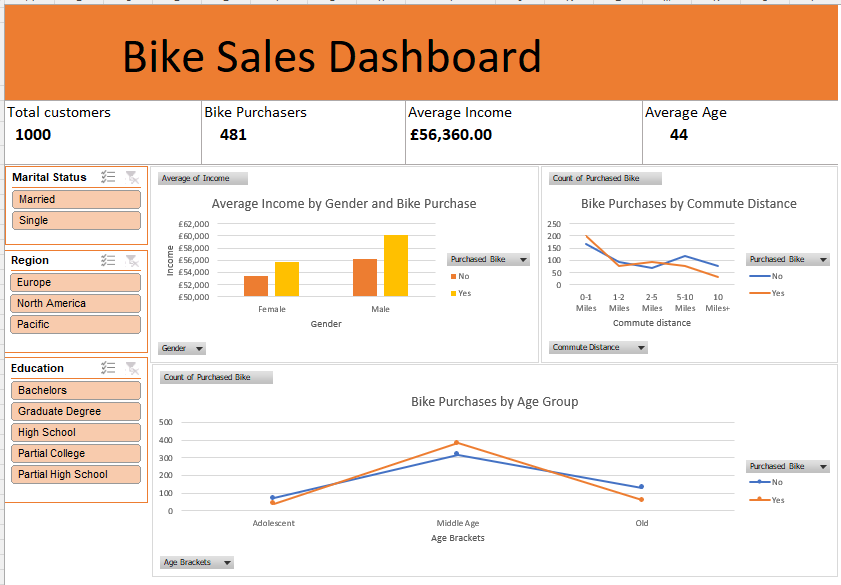
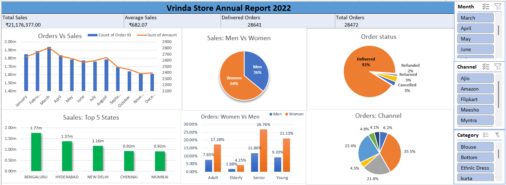

# Excel-Projects-Portfolio
Excel Projects Portfolio – A collection of Excel projects demonstrating my learning and practical skills in Excel formulas, data analysis, PivotTables, charts and interactive dashboards.

## Skills and Tools used:
- Microsoft Excel
- Excel Formulas and Calculations
- PivotTables and PivotCharts
- Interactive Slicers
- Data Analysis and Visualisation
- Dashboard Design

# 1. Bike Sales Dashboard
An interactive dashboard designed to analyse customer characteristics and identify patterns in bike purchasing behaviour.

## Key Features:

- Customer Overview: Total customers, bike purchasers, average income and average age.
- Income Analysis: Average income by gender and bike purchasing status.
- Commute Analysis: Bike purchasing behaviour by commute distance.
- Age Group Analysis: Comparison of bike purchasing across different age groups.
- Interactive Filters: Slicers for marital status, region and education.

## Project Files
- Bike_Sales_Dashboard.xlsx – Excel workbook containing the dashboard, working sheet, PivotTables and relevant formulas.

## Dashboard Preview

# 2. Vrinda Store Annual Report 2022
An interactive Excel dashboard analysing Vrinda Store's annual sales performance in 2022, with a focus on sales trends, customer demographics and order fulfilment.

## Key Performance Indicators
- Total Sales: ₹21,176,377
- Average Sales: ₹682.07
- Delivered Orders: 28,641
- Total Orders: 28,472
  
## Key Features
- Gender Analysis: Comparison of sales and orders between women and men.
- Sales Channel Analysis: Comparison of orders across different online platforms.
- Age Group Analysis: Understanding purchasing patterns across different age groups.
- Monthly Sales Trends: Analysis of sales performance across the year.
- Geographical Sales Analysis: Top 5 states contributing to overall sales.
- Interactive Dashboard: PivotTables, PivotCharts and slicers for filtering and exploring sales data.

## Project Files
- Vrinda_Store_Annual_Report_2022.xlsx – Excel workbook containing the dashboard, source data, PivotTables and PivotCharts.

## Dashboard Preview

